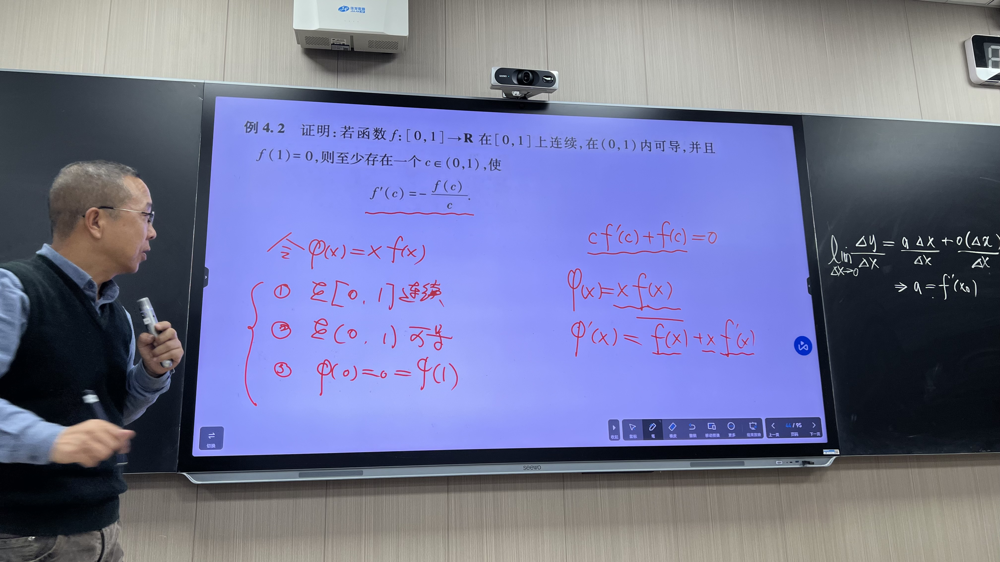

# 例 4.2 · 构造辅助函数应用罗尔定理

## 题目

证明：若函数 $f:[0,1]\to\mathbb{R}$ 在 $[0,1]$ 上连续，在 $(0,1)$ 内可导，并且 $f(1)=0$，则至少存在一个 $c\in(0,1)$，使

$$
f'(c)=-\frac{f(c)}{c}.
$$

## 我的做法

个人解题过程待补充。

## 正确思路

把目标等式改写成 $cf'(c)+f(c)=0$。左边正是 $xf(x)$ 在 $x=c$ 处的导数，所以设辅助函数 $\varphi(x)=xf(x)$，再用罗尔定理找导数为零的点。

由乘积的连续性与可导性，$\varphi$ 在 $[0,1]$ 上连续，在 $(0,1)$ 内可导，且

$$
\varphi'(x)=f(x)+xf'(x),\qquad x\in(0,1).
$$

两个端点分别给出 $\varphi(0)=0\cdot f(0)=0$ 和 $\varphi(1)=f(1)=0$。因此罗尔定理的条件全部满足，至少存在一个 $c\in(0,1)$ 使

$$
0=\varphi'(c)=f(c)+cf'(c).
$$

由于 $c>0$，两边除以 $c$ 并整理，得到 $f'(c)=-f(c)/c$。

## 可迁移的教训

见到〔要证明某个内点满足 $cf'(c)+f(c)=0$〕→ 想到〔用乘积求导识别辅助函数 $xf(x)$，再逐项检查它是否满足罗尔定理的条件。这里左端点由因子 $x$ 置零，右端点由题设 $f(1)=0$ 置零〕。
