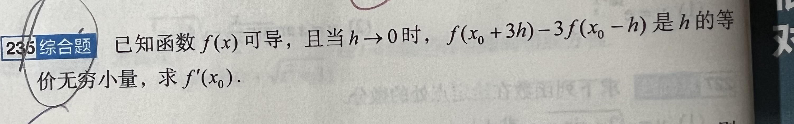

# 第 235 题 · 等价无穷小与导数定义

## 题目

已知函数 $f(x)$ 可导，且当 $h\to0$ 时，$f(x_0+3h)-3f(x_0-h)$ 是 $h$ 的等价无穷小，求 $f'(x_0)$。

## 我的做法

第一次没有做出来。

## 错在哪

首做未完成推导，本题的解题入口是把等价关系写成比值极限。

## 正确思路

先用等价关系和连续性求出 $f(x_0)$，再把比值拆成两个导数差商。

由等价无穷小的定义，

$$
\lim_{h\to0}\frac{f(x_0+3h)-3f(x_0-h)}{h}=1.
$$

因为 $h\to0$ 而这个比值趋于 $1$，所以分子趋于 $0$。又因为 $f$ 在 $x_0$ 可导，从而在 $x_0$ 连续，分子的极限也是 $f(x_0)-3f(x_0)=-2f(x_0)$。于是 $f(x_0)=0$。

当 $h\ne0$ 时，利用 $f(x_0)=0$ 写成

$$
\begin{aligned}
\frac{f(x_0+3h)-3f(x_0-h)}{h}
&=3\frac{f(x_0+3h)-f(x_0)}{3h}
+3\frac{f(x_0-h)-f(x_0)}{-h}.
\end{aligned}
$$

第二项的正号来自分母换成 $-h$。当 $h\to0$ 时，$3h$ 和 $-h$ 都趋于 $0$。由 $f$ 在 $x_0$ 可导，两个差商都趋于 $f'(x_0)$，所以 $6f'(x_0)=1$，即 $\boxed{f'(x_0)=\frac16}$。

## 可迁移的教训

见到〔几个邻近点的函数值作线性组合，整体与 $h$ 等价〕→ 想到〔写成比值趋于 $1$，先用连续性处理常数项，再按实际增量凑导数差商，留意负增量的符号〕。
