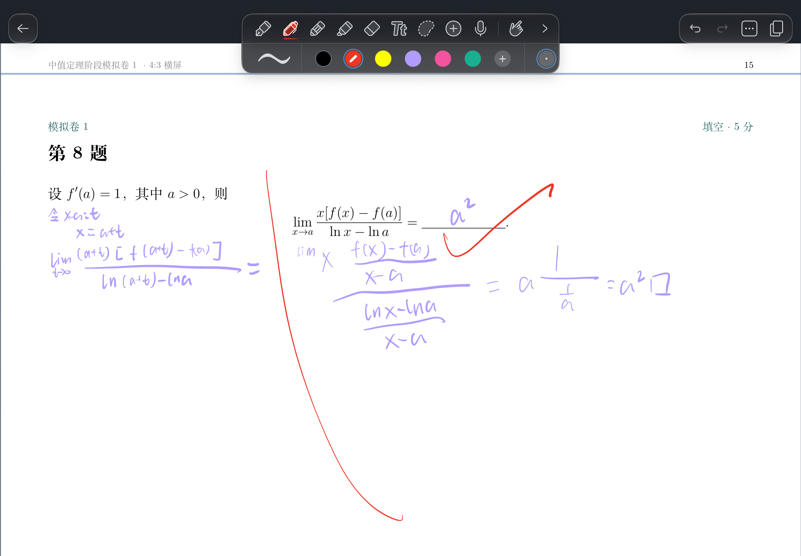

# 第 8 题 · 用导数定义求对数差值的极限

## 题目

设 $f'(a)=1$，其中 $a>0$，求

$$
\lim_{x\to a}\frac{x[f(x)-f(a)]}{\ln x-\ln a}.
$$

## 我的做法

第一次先设 $t=x-a$，于是 $x=a+t$。我把原式写到

$$
\lim_{t\to 0}\frac{(a+t)[f(a+t)-f(a)]}{\ln(a+t)-\ln a}，
$$

接下来没有想到怎么用题目给的 $f'(a)=1$。题图右边是看解析之后写的过程：分子、分母同除以 $x-a$，分别认出两个导数差商，得到 $a^2$。

## 错在哪

换元是正确的，卡在没有从 $f'(a)=1$ 想到给 $f(a+t)-f(a)$ 配上分母 $t$，凑出极限已知的差商。

## 正确思路

先问自己：题目给的 $f'(a)=1$ 是哪个式子的极限？按导数定义，$\frac{f(a+t)-f(a)}{t}\to1$。换元后的分子已经出现 $f(a+t)-f(a)$，差商只缺一个分母 $t$。把整个分子和分母同时除以 $t$，原来的比值保持不变，对数的差值也恰好变成了同一点的差商。

沿着第一次的换元，当 $t\ne0$ 且 $|t|<a/2$ 时，$a+t>0$，且由 $\ln$ 的严格单调性可知 $\ln(a+t)-\ln a\ne0$，所以

$$
\frac{(a+t)[f(a+t)-f(a)]}{\ln(a+t)-\ln a}
=(a+t)\frac{\dfrac{f(a+t)-f(a)}{t}}{\dfrac{\ln(a+t)-\ln a}{t}}.
$$

当 $t\to0$ 时，上面的差商趋于 $f'(a)=1$，下面的差商趋于 $(\ln)'(a)=1/a$。因为 $1/a\ne0$，可以用商的极限法则。再乘上 $a+t$ 的极限 $a$，得

$$
\lim_{x\to a}\frac{x[f(x)-f(a)]}{\ln x-\ln a}
=a\cdot\frac{1}{1/a}
=\boxed{a^2}.
$$

## 可迁移的教训

见到〔题目给出 $f'(a)$，比值里出现 $f(x)-f(a)$〕→ 想到〔先找导数定义里的增量 $x-a$，让分子、分母同除以这个增量，再检查分母差商的极限是否非零。若已换元为 $t=x-a$，就直接同除以 $t$〕。
