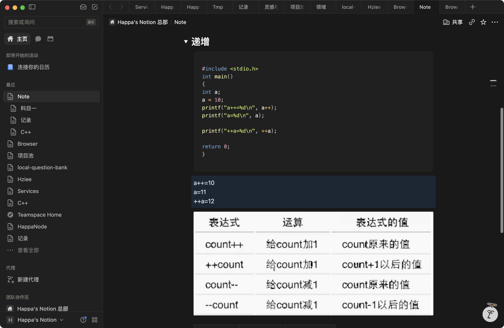

# 自增与自减

## 核心规则

`++` 使变量加 1，`--` 使变量减 1。前置与后置的区别在于**表达式取什么值**。以下以整数变量为例，并假设运算结果在其类型的可表示范围内。

设 `count` 运算前的值为 `n`，每行分别从这个初始值开始：

| 表达式 | 对变量的操作 | 表达式的值 | 运算完成后 `count` 的值 |
| --- | --- | --- | --- |
| `count++` | 加 1 | 原值 `n` | `n + 1` |
| `++count` | 加 1 | 新值 `n + 1` | `n + 1` |
| `count--` | 减 1 | 原值 `n` | `n - 1` |
| `--count` | 减 1 | 新值 `n - 1` | `n - 1` |

记忆：**后置取旧值，前置取新值；变量都会更新。**

## 截图中的示例

保留截图中的代码，仅整理缩进。原笔记没有注明语言版本或编译器；本次按 C17 验证。

```c
#include <stdio.h>
int main()
{
    int a;
    a = 10;
    printf("a++=%d\n", a++);
    printf("a=%d\n", a);

    printf("++a=%d\n", ++a);

    return 0;
}
```

实际输出：

```text
a++=10
a=11
++a=12
```

## 逐句执行

| 语句 | 传给 `%d` 的值 | 本条完整语句执行后 `a` 的值 |
| --- | --- | --- |
| `a = 10;` | — | `10` |
| `printf("a++=%d\n", a++);` | `10`：后置表达式取原值 | `11` |
| `printf("a=%d\n", a);` | `11`：读取当前变量值 | `11` |
| `printf("++a=%d\n", ++a);` | `12`：先加 1，再取新值 | `12` |

第一行输出中的 `a++=` 是字符串里的固定文字，`%d` 对应的实参才会执行自增。第二条 `printf` 读取 `a` 时，上一条完整语句中的自增已经完成。

## 可迁移的教训

- 见到 `变量++` 或 `变量--` → 分别记录表达式取到的旧值和变量更新后的新值。
- 见到 `++变量` 或 `--变量` → 先计算新值，再把新值作为表达式的值。
- 见到连续语句中的自增、自减 → 用上一条完整语句执行后的变量值继续推算。
- 见到单独一条 `a++;` 或 `++a;` → 表达式的值被舍弃，两者都使 `a` 加 1。

## 验证记录

2026-10-28 使用 Apple Clang 17.0.0，以 `-std=c17 -Wall -Wextra -pedantic` 编译运行，输出与截图一致；独立断言验证了初值为 `10` 时表格中四种运算的表达式值和最终变量值。

原代码的 `int main()` 触发 `-Wstrict-prototypes` 警告，编译与运行成功。在 C17 中，推荐使用 `int main(void)` 明确声明无参数；本笔记保留截图原文。

## 来源

本条记录整理截图中可见的“递增”代码、输出与自增自减表格。截图未提供错误过程或具体疑问，按知识笔记归档。


